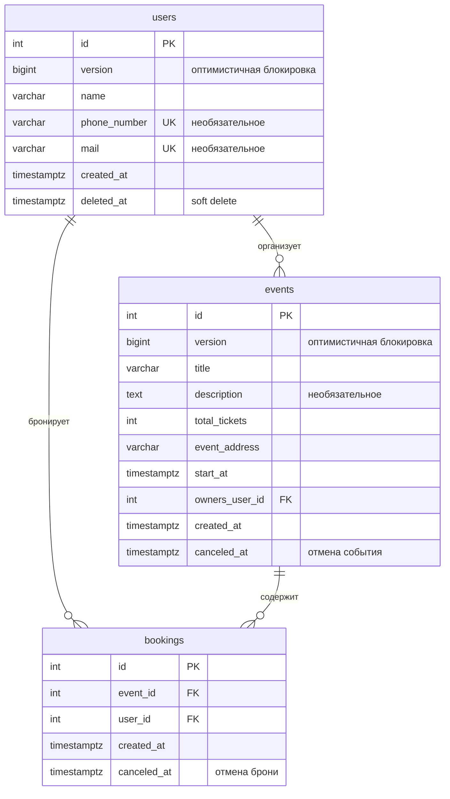

# Booking API

REST API для бронирования билетов на мероприятия. Пользователи создают события, остальные бронируют на них места, при удалении аккаунта данные анонимизируются, а связанные брони корректно закрываются.

**Go · PostgreSQL · pgx · Docker Compose · Swagger**

Это мой первый backend-проект. Я делал его, чтобы разобраться, как проектируется и пишется сервис «с нуля»: от схемы БД и транзакций до структуры кода и запуска в контейнерах.

---

## Что в проекте

| Тема | Что сделано |
|---|---|
| **Корректность данных при конкурентном доступе** | Бронирование выполняется в одной транзакции: блокировка события `SELECT … FOR UPDATE`, подсчёт активных броней и вставка. Два параллельных запроса не смогут занять последнее место. |
| **Транзакции** | Удаление пользователя, отмена события и отмена брони реализованы транзакциями, которые не оставляют базу в промежуточном состоянии. |
| **Soft delete и анонимизация** | Пользователь не удаляется физически: его персональные данные обезличиваются, будущие события отменяются, активные брони закрываются. История остаётся целой. |
| **Оптимистичная блокировка** | Событие и пользователь обновляются с проверкой поля `version`. Если запись изменили параллельным запросом между чтением и записью, клиент получает `409 Conflict`, а не молча затирает чужие изменения. |
| **Целостность на уровне БД** | Ограничения `CHECK`, `UNIQUE`, внешние ключи, частичный индекс по активным броням. Валидация есть и в приложении, и в базе. |
| **Структура кода** | Разбиение по фичам (`users`, `events`, `bookings`) и слоям `transport → service → repository`, общий код вынесен в `core`. |
| **HTTP-слой** | Собственные middleware: CORS, request ID, логирование запросов, восстановление после паники. Единый формат ошибок, корректные коды ответов. |
| **Конфигурация** | Настройки из переменных окружения, graceful shutdown, ограничение размера страницы в списках (по умолчанию 50, максимум 200). |
| **Документация API** | Swagger, который генерируется из аннотаций в коде. |
| **Окружение** | Postgres, миграции и приложение запускаются через Docker Compose, рутинные действия вынесены в `Makefile`. |

---

## Быстрый старт

Нужны **Docker** (с Docker Compose) и **make**. Устанавливать Go локально не требуется, приложение собирается внутри контейнера.

```bash
# 1. Создать файл с настройками и заполнить POSTGRES_USER, POSTGRES_PASSWORD, POSTGRES_DB
cp .env.example .env

# 2. Поднять PostgreSQL
make env-up

# 3. Применить миграции (если команда не подключилась, подождите несколько секунд, пока база стартует, и повторите)
make migrate-up

# 4. Собрать и запустить приложение
make app-deploy
```

После этого:

- API: `http://127.0.0.1:5050/api/v1`
- Swagger UI: `http://127.0.0.1:5050/swagger/`

Остановить: `make app-undeploy` и `make env-down`.

### Запуск без контейнера для приложения

Если нужно запускать код локально (нужен Go 1.26+):

```bash
make env-up
make env-port-forwarder   # открывает порт Postgres на 127.0.0.1:5432
make migrate-up
make app-run
```

### Переменные окружения

| Переменная | Назначение | Пример |
|---|---|---|
| `POSTGRES_USER`, `POSTGRES_PASSWORD`, `POSTGRES_DB` | Доступ к базе | заполняются вручную |
| `POSTGRES_TIMEOUT` | Таймаут подключения к базе | `10s` |
| `LOGGER_LEVEL` | Уровень логирования | `DEBUG` |
| `HTTP_ADDR` | Адрес HTTP-сервера | `:5050` |
| `HTTP_SHUTDOWN_TIMEOUT` | Время на graceful shutdown | `30s` |
| `TIME_ZONE` | Часовой пояс приложения | `UTC` |
| `ALLOWED_ORIGINS` | Разрешённые источники для CORS | `http://localhost:5050` |

---

## API

Базовый путь: `/api/v1`. Полное описание запросов и ответов лежит в Swagger.

| Метод | Путь | Описание |
|---|---|---|
| `POST` | `/users` | Создать пользователя |
| `GET` | `/users` | Список пользователей (пагинация) |
| `GET` | `/users/{id}` | Получить пользователя |
| `PATCH` | `/users/{id}` | Изменить пользователя (с проверкой `version`) |
| `DELETE` | `/users/{id}` | Удалить пользователя: анонимизация, отмена его будущих событий и броней |
| `POST` | `/events` | Создать событие |
| `GET` | `/events` | Список событий: фильтры `ownerId`, `title`, `address`, `dateFrom`, `dateTo`, пагинация |
| `GET` | `/events/{id}` | Получить событие |
| `PATCH` | `/events/{id}` | Изменить событие (с проверкой `version`) |
| `POST` | `/events/{id}/cancel` | Отменить событие и все его брони |
| `POST` | `/books` | Забронировать место на событие |
| `GET` | `/books` | Список броней: фильтры `userId`, `eventId`, `dateFrom`, `dateTo`, пагинация |
| `GET` | `/books/{id}` | Получить бронь |
| `POST` | `/books/{id}/cancel` | Отменить бронь |

### Правила бронирования

- Бронь занимает одно место.
- Нельзя бронировать отменённое или уже начавшееся событие.
- Один пользователь может держать не больше 5 активных броней на одно событие.
- Нельзя занять больше мест, чем указано в `total_tickets`.
- Изменить или отменить уже начавшееся событие нельзя.
- Нельзя уменьшить число билетов ниже числа уже активных броней.

---

## Демонстрация API

Пошаговый сценарий с готовыми командами `curl`: от создания данных до каскадной отмены. Раскройте блок ниже.

<details>
<summary><b>Показать сценарий (11 шагов)</b></summary>

Сценарий ниже можно выполнить по порядку на чистой базе: тогда идентификаторы начнутся с `1` и совпадут с теми, что в примерах. Он показывает основные возможности: создание данных, бронирование, защиту от перебронирования, отмену и каскадные действия при удалении пользователя.

Для удобства задайте адрес API и дату начала события. Дата должна быть в будущем (формат RFC 3339); если вы запускаете сценарий спустя долгое время, поменяйте год:

```bash
BASE=http://127.0.0.1:5050/api/v1
STARTS_AT="2027-12-20T19:30:00Z"
```

Флаг `-i` в командах выводит код ответа вместе с телом. В примерах ниже оставлены статус и тело ответа, служебные заголовки опущены.

### 1. Создать организатора и двух гостей

```bash
curl -i -s -X POST $BASE/users -H 'Content-Type: application/json' \
  -d '{"name": "Olga Organizer", "phone_number": "+79990000001", "mail": "olga@example.com"}'

curl -i -s -X POST $BASE/users -H 'Content-Type: application/json' \
  -d '{"name": "Ivan Ivanov", "phone_number": "+79990000002", "mail": "ivan@example.com"}'

curl -i -s -X POST $BASE/users -H 'Content-Type: application/json' \
  -d '{"name": "Petr Petrov", "phone_number": "+79990000003", "mail": "petr@example.com"}'
```

Ответ (запрос 1):

```http
HTTP/1.1 201 Created

{
  "id": 1,
  "version": 1,
  "name": "Olga Organizer",
  "phone_number": "+79990000001",
  "mail": "olga@example.com",
  "created_at": "2026-11-02T00:59:55.900158Z"
}
```

Ответ (запрос 2):

```http
HTTP/1.1 201 Created

{
  "id": 2,
  "version": 1,
  "name": "Ivan Ivanov",
  "phone_number": "+79990000002",
  "mail": "ivan@example.com",
  "created_at": "2026-11-02T01:00:12.984515Z"
}
```

Ответ (запрос 3):

```http
HTTP/1.1 201 Created

{
  "id": 3,
  "version": 1,
  "name": "Petr Petrov",
  "phone_number": "+79990000003",
  "mail": "petr@example.com",
  "created_at": "2026-11-02T01:00:30.8546Z"
}
```

### 2. Валидация и уникальность

Слишком короткое имя, должна вернуться ошибка валидации:

```bash
curl -i -s -X POST $BASE/users -H 'Content-Type: application/json' \
  -d '{"name": "Al"}'
```

Повторная почта, должен сработать `UNIQUE` из базы:

```bash
curl -i -s -X POST $BASE/users -H 'Content-Type: application/json' \
  -d '{"name": "Another Ivan", "mail": "ivan@example.com"}'
```

Ответ (валидация):

```http
HTTP/1.1 400 Bad Request

{
  "error": "request validation: Key: 'CreateUserRequestDTO.Name' Error:Field validation for 'Name' failed on the 'min' tag: invalid argument",
  "message": "decode request"
}
```

Ответ (дубликат почты):

```http
HTTP/1.1 409 Conflict

{
  "error": "create user repository error: phone number or mail is already in use: ERROR: duplicate key value violates unique constraint \"users_mail_key\" (SQLSTATE 23505): violates unique: conflict",
  "message": "create user"
}
```

### 3. Создать событие всего на 2 места

Так будет проще показать, что места заканчиваются.

```bash
curl -i -s -X POST $BASE/events -H 'Content-Type: application/json' -d @- <<EOF
{
  "title": "Jazz night",
  "description": "Live jazz in a small club",
  "total_tickets": 2,
  "address": "Moscow, Tverskaya st. 1",
  "starts_at": "$STARTS_AT",
  "owner_user_id": 1
}
EOF
```

Ответ:

```http
HTTP/1.1 201 Created

{
  "id": 1,
  "version": 1,
  "title": "Jazz night",
  "description": "Live jazz in a small club",
  "total_tickets": 2,
  "created_at": "2026-11-02T01:02:48.085181Z",
  "address": "Moscow, Tverskaya st. 1",
  "starts_at": "2027-12-20T19:30:00Z",
  "owner_user_id": 1,
  "canceled_at": null
}
```

### 4. Список событий с фильтром

```bash
curl -i -s "$BASE/events?title=jazz&limit=10"
```

Ответ:

```http
HTTP/1.1 200 OK

[
  {
    "id": 1,
    "version": 1,
    "title": "Jazz night",
    "description": "Live jazz in a small club",
    "total_tickets": 2,
    "created_at": "2026-11-02T01:02:48.085181Z",
    "address": "Moscow, Tverskaya st. 1",
    "starts_at": "2027-12-20T19:30:00Z",
    "owner_user_id": 1,
    "canceled_at": null
  }
]
```

### 5. Забронировать места

Оба гостя занимают по одному месту:

```bash
curl -i -s -X POST $BASE/books -H 'Content-Type: application/json' \
  -d '{"event_id": 1, "user_id": 2}'

curl -i -s -X POST $BASE/books -H 'Content-Type: application/json' \
  -d '{"event_id": 1, "user_id": 3}'
```

Ответ (бронь 1):

```http
HTTP/1.1 201 Created

{
  "id": 1,
  "event_id": 1,
  "user_id": 2,
  "created_at": "2026-11-02T01:03:53.023086Z",
  "canceled_at": null
}
```

Ответ (бронь 2):

```http
HTTP/1.1 201 Created

{
  "id": 2,
  "event_id": 1,
  "user_id": 3,
  "created_at": "2026-11-02T01:05:43.113497Z",
  "canceled_at": null
}
```

### 6. Места закончились

Первый гость пытается занять ещё одно место. Свободных нет, ожидается конфликт:

```bash
curl -i -s -X POST $BASE/books -H 'Content-Type: application/json' \
  -d '{"event_id": 1, "user_id": 2}'
```

Ответ:

```http
HTTP/1.1 409 Conflict

{
  "error": "failed to create book: no avaliable tickets: conflict",
  "message": "failed to create book"
}
```

### 7. Нельзя убрать билеты, которые уже забронированы

Попытка уменьшить `total_tickets` до 1, когда активных броней две:

```bash
curl -i -s -X PATCH $BASE/events/1 -H 'Content-Type: application/json' \
  -d '{"total_tickets": 1}'
```

Ответ:

```http
HTTP/1.1 409 Conflict

{
  "error": "failed to patch event in repository: already booked tickets more than total: conflict",
  "message": "failed to patch event"
}
```

### 8. Отменить бронь и занять освободившееся место

```bash
curl -i -s -X POST $BASE/books/1/cancel

curl -i -s -X POST $BASE/books -H 'Content-Type: application/json' \
  -d '{"event_id": 1, "user_id": 2}'
```

Ответ (отмена):

```http
HTTP/1.1 200 OK

{
  "id": 1,
  "event_id": 1,
  "user_id": 2,
  "created_at": "2026-11-02T01:03:53.023086Z",
  "canceled_at": "2026-11-02T01:07:07.193437Z"
}
```

Ответ (новая бронь):

```http
HTTP/1.1 201 Created

{
  "id": 3,
  "event_id": 1,
  "user_id": 2,
  "created_at": "2026-11-02T01:07:25.918158Z",
  "canceled_at": null
}
```

### 9. Список броней события

В списке должна быть и отменённая бронь (с `canceled_at`), и активные:

```bash
curl -i -s "$BASE/books?eventId=1"
```

Ответ:

```http
HTTP/1.1 200 OK

[
  {
    "id": 1,
    "event_id": 1,
    "user_id": 2,
    "created_at": "2026-11-02T01:03:53.023086Z",
    "canceled_at": "2026-11-02T01:07:07.193437Z"
  },
  {
    "id": 2,
    "event_id": 1,
    "user_id": 3,
    "created_at": "2026-11-02T01:05:43.113497Z",
    "canceled_at": null
  },
  {
    "id": 3,
    "event_id": 1,
    "user_id": 2,
    "created_at": "2026-11-02T01:07:25.918158Z",
    "canceled_at": null
  }
]
```

### 10. Удалить гостя: его бронь закрывается

```bash
curl -i -s -X DELETE $BASE/users/3
curl -i -s "$BASE/books?eventId=1"
```

Ответ (удаление):

```http
HTTP/1.1 204 No Content
```

Ответ (список броней после удаления):

```http
HTTP/1.1 200 OK

[
  {
    "id": 1,
    "event_id": 1,
    "user_id": 2,
    "created_at": "2026-11-02T01:03:53.023086Z",
    "canceled_at": "2026-11-02T01:07:07.193437Z"
  },
  {
    "id": 2,
    "event_id": 1,
    "user_id": 3,
    "created_at": "2026-11-02T01:05:43.113497Z",
    "canceled_at": "2026-11-02T01:08:26.964917Z"
  },
  {
    "id": 3,
    "event_id": 1,
    "user_id": 2,
    "created_at": "2026-11-02T01:07:25.918158Z",
    "canceled_at": null
  }
]
```

### 11. Удалить организатора: его событие отменяется

```bash
curl -i -s -X DELETE $BASE/users/1
curl -i -s $BASE/events/1
```

Ответ (удаление):

```http
HTTP/1.1 204 No Content
```

Ответ (событие после удаления организатора):

```http
HTTP/1.1 200 OK

{
  "id": 1,
  "version": 2,
  "title": "Jazz night",
  "description": "Live jazz in a small club",
  "total_tickets": 2,
  "created_at": "2026-11-02T01:02:48.085181Z",
  "address": "Moscow, Tverskaya st. 1",
  "starts_at": "2027-12-20T19:30:00Z",
  "owner_user_id": 1,
  "canceled_at": "2026-11-02T01:10:36.417153Z"
}
```

Бронирование на отменённое событие больше невозможно:

```bash
curl -i -s -X POST $BASE/books -H 'Content-Type: application/json' \
  -d '{"event_id": 1, "user_id": 2}'
```

Ответ:

```http
HTTP/1.1 409 Conflict

{
  "error": "failed to create book: event with id='1' is already canceled: conflict",
  "message": "failed to create book"
}
```

Все запросы можно выполнять и через Swagger UI: `http://127.0.0.1:5050/swagger/`.

</details>

---

## Структура проекта

```
cmd/booking/            точка входа, Dockerfile
internal/
  core/                 общий код: конфиг, логгер, пул подключений к БД,
                        HTTP-сервер, middleware, ошибки, доменные модели
  features/
    users/              transport → service → repository
    events/             transport → service → repository
    bookings/           transport → service → repository
migrations/             SQL-миграции
docs/                   сгенерированный Swagger
docker-compose.yaml     Postgres, миграции, приложение
.dockerignore           исключает out/ (данные Postgres) из контекста сборки образа
makefile                команды для окружения, миграций и запуска
```

## Схема данных

Три таблицы в схеме `booking`:



- `users`: имя, телефон и почта (уникальные), `deleted_at` для soft delete, `version`.
- `events`: название, описание, адрес, время начала, число билетов, организатор, `canceled_at`, `version`.
- `bookings`: событие, пользователь, `canceled_at`.

Для подсчёта активных броней события используется частичный индекс `(event_id, user_id) WHERE canceled_at IS NULL`.

---

## Что дальше

- **Тесты.** Сейчас проект проверялся вручную через Swagger и curl, автотестов пока нет.
- **Аутентификация и авторизация.** Сейчас идентификатор пользователя приходит в запросе, и права на отмену не проверяются.
- **Ограничения HTTP-сервера.** Лимит размера тела запроса и таймауты на чтение заголовков.

---

## Автор

Александр Тарханов, студент 4 курса МАИ, ищу работу Go backend-разработчиком.

Telegram: `@prkfchel` · Email: `tarhanovsasa9@gmail.com` · GitHub: `prkfchel`